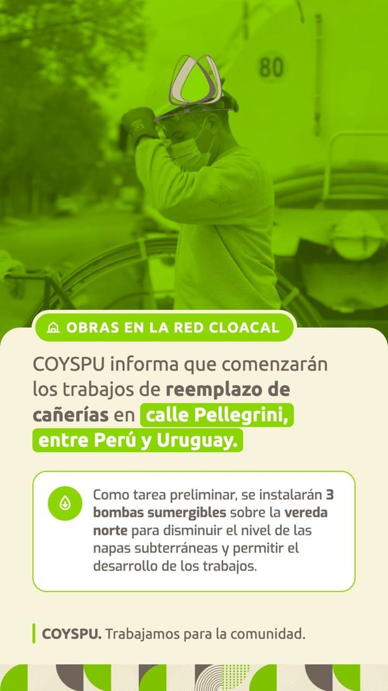

COYSPU va a reemplazar las cañerías cloacales de calle Pellegrini, en el tramo entre Perú y Uruguay. La obra ya empezó, aunque todavía está en la etapa previa a la excavación.

Eso explica algo que los vecinos vienen notando: el agua que corre por la cuneta en ese sector no es una pérdida, es parte del procedimiento.

## Por qué hay que bombear

Antes de poder excavar, la cooperativa necesita bajar el nivel de las napas subterráneas. Para eso instaló tres bombas sumergibles sobre la vereda norte.

Hoy la napa está a unos tres metros de profundidad. El objetivo es llevarla a entre 3,70 y 3,80 metros, que es la condición necesaria para abrir la zanja y después reemplazar los caños.

## A dónde va el agua

El agua que extraen las bombas se conduce por la cuneta de Pellegrini, desde Uruguay hasta la boca de tormenta de calle Laprida, donde se descarga.

Ese recorrido es el que explica la presencia de agua en las cuadras intermedias mientras duren las tareas.

## Parte de la renovación de la red

La obra se enmarca en el proceso de renovación de la infraestructura cloacal que viene llevando adelante la cooperativa.

Desde el municipio pidieron a los vecinos tener en cuenta la situación al circular por el sector.
