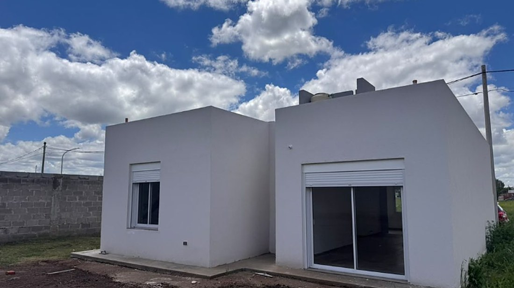

El Programa Municipal de Vivienda sumó este martes una casa más. Francisco De Rico recibió las llaves de la vivienda número 268 del PRO.MU.VI., ubicada en calle 9 de Julio 1531, en el barrio Oddo.

La entrega se hizo en el lugar, con la familia adjudicataria recorriendo la casa terminada.

## Cuatro casas en poco más de un mes

Es la cuarta vivienda que el programa entrega en las últimas semanas. A fines de octubre fue la 265, el 3 de noviembre la 266 en barrio Elevación y el 6 la 267, en calle 25 de Diciembre.

La seguidilla se da en el tramo final de la gestión municipal: el 10 de diciembre asume Germán Font, que ganó las elecciones de septiembre.

## Qué es el PRO.MU.VI.

El Programa Municipal de Vivienda es el plan con el que el municipio construye y adjudica casas en distintos barrios de la ciudad. Desde su creación lleva 268 viviendas entregadas.

Para muchas familias de Marcos Juárez es la vía para llegar a la casa propia, un proyecto que de otro modo queda lejos del alcance.
