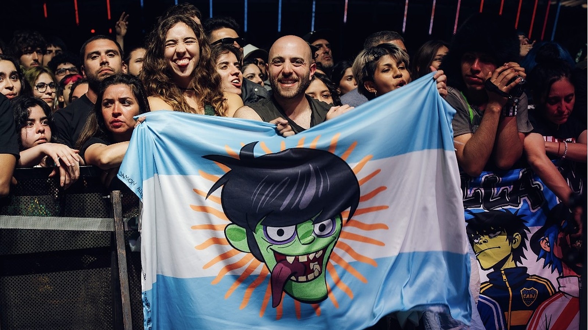
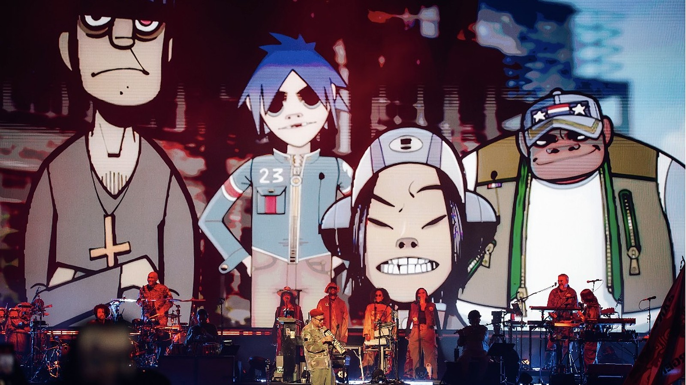
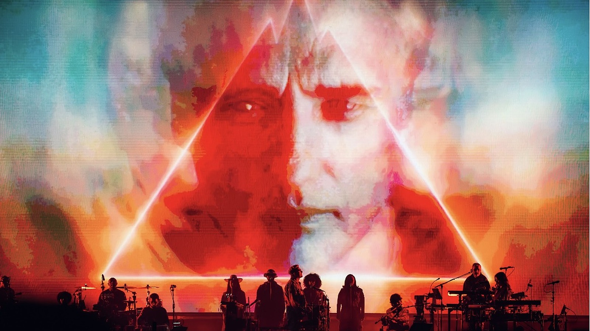
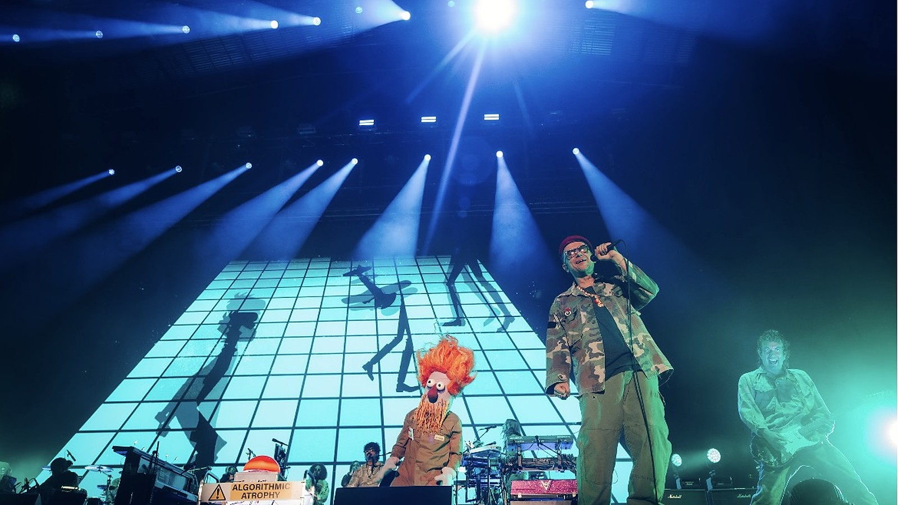

Gorillaz tocó por primera vez en Córdoba. Fue la noche del jueves en el playón norte del estadio Mario Alberto Kempes, donde las estimaciones hablaron de entre 28 y 30 mil personas. El show formó parte de The Mountain Tour, la gira con la que la banda presenta su noveno disco, y lo trajo a la provincia la productora En Vivo Producciones.

Las puertas se abrieron a las 18 y la explanada se fue llenando temprano. Una parte del público llegó disfrazada de los personajes animados del proyecto, una costumbre que acompaña a la banda desde sus primeros años y que anoche se vio en gente de todas las edades.

## Dos teloneros antes del plato fuerte

La apertura quedó en manos del Dúo Mixo, un grupo cordobés de sonido sintético que se presentó con tres integrantes. Después llegó el turno de Luisa Almaguer, cantautora mexicana de impronta shoegaze, que además del repertorio dedicó varios minutos a hablar de la situación política en América Latina.

Poco después de las 21 se apagaron las luces y Damon Albarn salió entre humo y gritos. Llevaba un equipo de camuflaje militar, boina roja y anteojos, un vestuario ligado al concepto del disco nuevo.

## La India, el visual y los clásicos

El recital arrancó con *The Mountain* y siguió con *The Happy Dictator* y *Tranz*, esta última con su video en tonos de neón detrás de la banda. Entre los músicos hubo instrumentistas con instrumentos clásicos de la India, uno de los rasgos sonoros del material reciente.

A partir de ahí la lista se corrió hacia los temas que el público esperaba: *Last Living Souls*, *Tomorrow Comes Today*, *19-2000* y *On Melancholy Hill*. En *Latin Simone*, Almaguer volvió al escenario para ocupar el lugar que en la grabación original tiene Ibrahim Ferrer.

El disco *Demon Days* fue el más presente de la noche, con ocho canciones. Entre ellas sonaron *DARE*, *November Has Come* y *Feel Good Inc.*, los momentos de mayor respuesta del campo.

## El cierre

Albarn bajó varias veces al vallado para cantar cerca de la gente y, en uno de los tramos finales, levantó una bandera de Palestina. Sobre el final llegaron *Dirty Harry* y *Clint Eastwood*, el tema con el que el proyecto se dio a conocer en 2001 y con el que terminó el show.

Una ausencia quedó marcada: no sonó *The Manifesto*, la canción del disco nuevo que la banda grabó con Trueno, y el rapero argentino tampoco apareció en escena. Gorillaz sigue su paso por el país este fin de semana en el festival Primavera Sound, en Buenos Aires.
