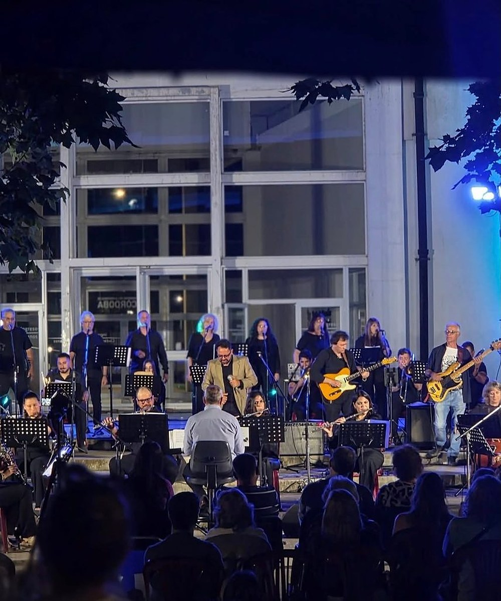
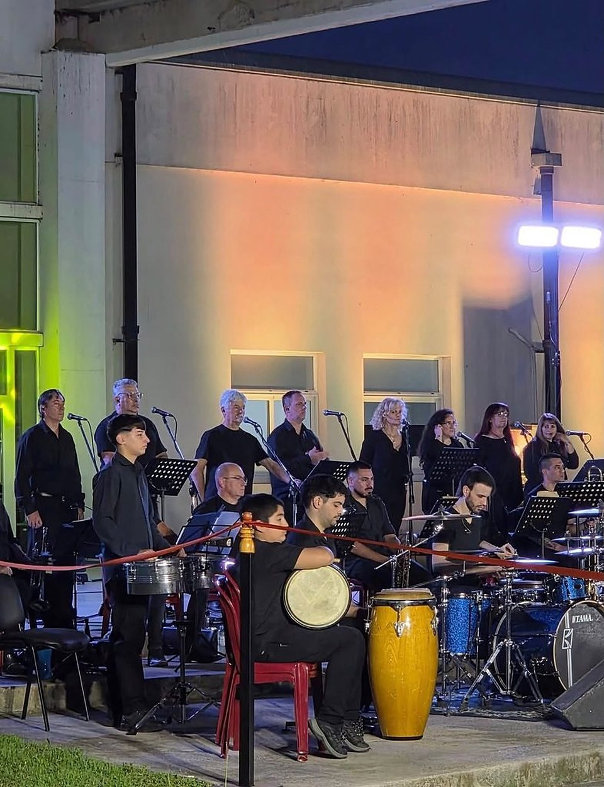

Las escalinatas del Centro Cívico se llenaron el domingo a la noche. La Banda Municipal José Cesanelli, el Coro Polifónico Municipal y un grupo de artistas invitados presentaron **"Piensa en mí"**, un espectáculo armado íntegramente con cuartetos del recuerdo.

Fueron quince canciones, y alcanzaron para que la gente cantara, bailara y se emocionara al aire libre. El repertorio cruzó generaciones: los clásicos que sonaban hace treinta o cuarenta años volvieron a escucharse frente al edificio, con público de todas las edades sentado en las escalinatas y en el pasto.

## Una propuesta por el Día de la Música

El show se realizó en el marco de las celebraciones por el Día de la Música, que se conmemora cada 22 de noviembre.

Sobre el escenario improvisado en la escalinata convivieron los vientos y las cuerdas de la banda, las voces del coro y los instrumentos de percusión que pide el género: congas, timbaletas y batería.

## El agradecimiento del cierre

Al finalizar, el maestro Diego del Bosco, que dirigió la presentación, agradeció a la intendenta Sara Majorel por el acompañamiento a las agrupaciones musicales durante los cuatro años de gestión.

Las dos formaciones que estuvieron en escena son municipales y vienen sosteniendo una agenda de presentaciones durante todo el año. La próxima cita ya está confirmada: el ciclo "Navidad en concierto" del Coro Polifónico, que se presenta el 8 de diciembre en Inriville y el 13 en Marcos Juárez.
