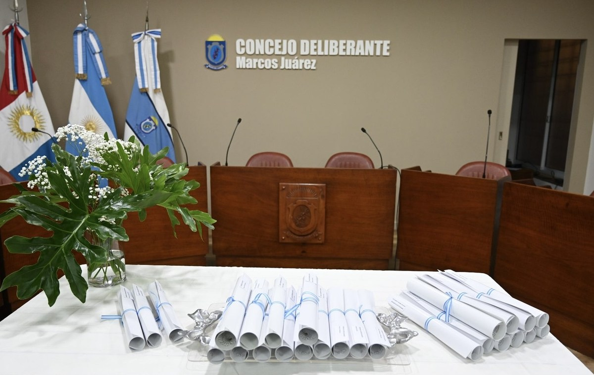
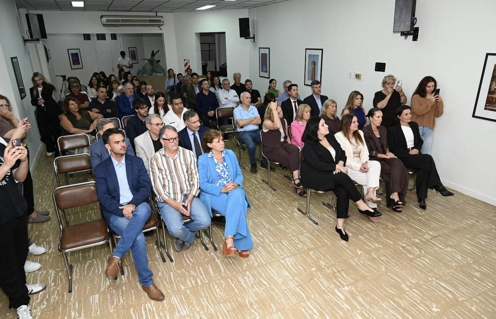

El recambio de autoridades en Marcos Juárez dio su paso formal. La Junta Electoral Municipal proclamó la noche del jueves, en el Concejo Deliberante, a quienes fueron elegidos en los comicios del 6 de septiembre y les entregó los diplomas que los habilitan a asumir el 10 de diciembre, para el período 2026-2030.

El acto se realizó en base a la Resolución N.º 23 de la Junta Electoral Municipal, firmada el 6 de octubre, que es el instrumento donde quedaron oficializados los resultados.

## Quiénes recibieron el diploma

**Intendente electo:** Germán Font, que asumirá la conducción del Ejecutivo municipal.

**Concejales electos:** Eduardo Foresi, Lucrecia Terenzani, Darío César Cano, Santiago Lambertucci, Jorge Brunori, Mariano Fidelio, Vilma Sigaudo, Maite Cisneros y Franco Maggi.

**Tribunos de cuentas electos:** Ivanna Merigo, Mariela Soledad Bracamonte y Próspero Reartes.

Tres de los nombres de la lista de concejales —Lucrecia Terenzani, Mariano Fidelio y Maite Cisneros— aparecen también entre los salientes, es decir que renuevan su lugar en el cuerpo.

Hay además dos casos que se van a definir en los próximos días: Terenzani y Lambertucci figuran entre los concejales electos y, al mismo tiempo, fueron anunciados por Font como integrantes de su gabinete, ella en la Secretaría de Coordinación y él en Desarrollo Social.

## El reconocimiento a los que se van

La Junta Electoral también entregó certificados a los funcionarios que terminan su mandato. La intendenta Sara Majorel recibió uno en reconocimiento a sus cuatro años de gestión.

Entre los concejales salientes fueron distinguidos Javier Barletta, Maite Cisneros, Maricel Serafini, Susana Cocchi, Alejandra Juich, Horacio Latimori, Lucrecia Terenzani, Maximiliano Villarreal González y Mariano Fidelio. Por el Tribunal de Cuentas, Ezequiel Cornaglia, Marcos Rossi y Virginia Tomassini.

Sobre el final, Majorel y Font entregaron juntos un ramo de flores a las integrantes de la Junta Electoral por el trabajo durante todo el proceso.

## Quiénes integran la Junta Electoral

El organismo que organizó y fiscalizó la elección está presidido por Paula Mercedes Lloret e integrado por Verónica Di Pompo y Luisina Liotta, con María Laura Capozuca como secretaria.

## Qué sigue

Con los diplomas entregados queda cerrado el capítulo electoral que empezó en septiembre. El 10 de diciembre asumen el intendente, el nuevo Concejo Deliberante y el Tribunal de Cuentas, y hasta entonces continúa la etapa de transición entre las dos gestiones.
